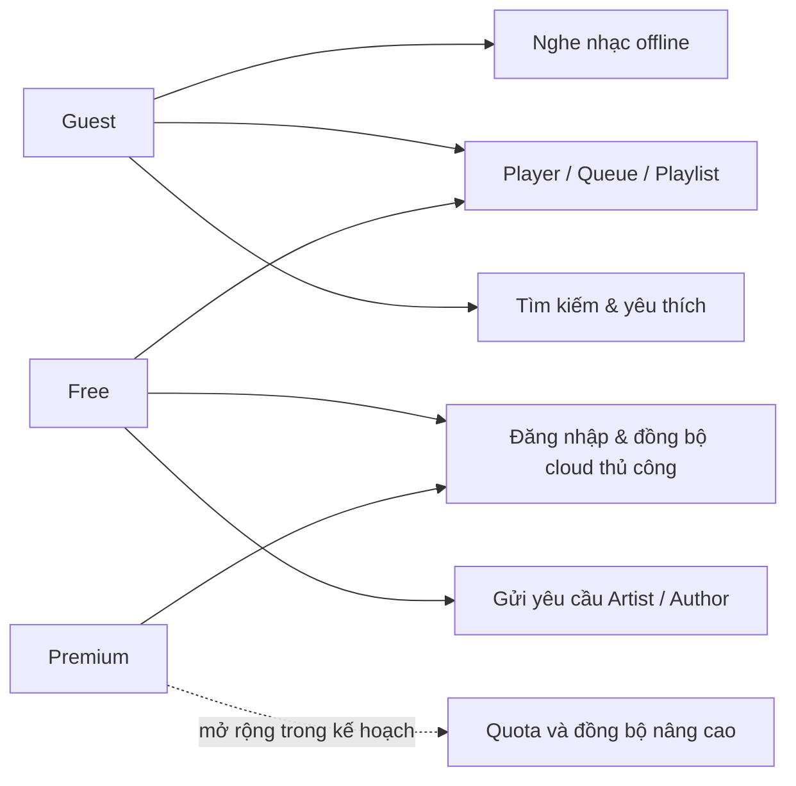
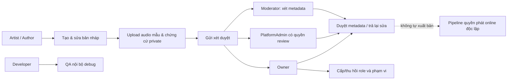

# MusicFlow — Actor & Use Case dành cho báo cáo dự án (2026-11-05)

> **Nguồn tham chiếu chính thức cho các lượt phát triển tiếp theo.** Đọc tài liệu này cùng [Ke_Hoach_Du_An.md](Ke_Hoach_Du_An.md), [Pham_Vi_MusicFlow_1_0.md](Pham_Vi_MusicFlow_1_0.md) và QA logs. Đây là **APK sideload + báo cáo môn học**, không phải phát hành thương mại. **Không được coi use case đang có mã nhưng chưa E2E là đã nghiệm thu hoàn chỉnh**. **Cập nhật 2026-11-07:** xem cuối mục 3 về UC-G13 — Quick Add Playlist, và `Playlist_Quick_Add_v1.md`.

## 1. Phân loại actor và gói dịch vụ

Hai trục **độc lập**:

- **Gói dịch vụ:** Guest (không đăng nhập), Free (tài khoản Supabase), Premium (entitlement Supabase; thanh toán thật chưa có). Premium **không** tự được quyền quản trị hoặc xuất bản.
- **Vai trò:** Listener (người nghe), Artist (nghệ sĩ), Author (tác giả), Moderator (kiểm duyệt tác phẩm), PlatformAdmin (quản trị viên cộng tác trong phạm vi), Owner (chủ sở hữu nền tảng), Developer (kỹ thuật/QA). Một tài khoản có thể đồng thời là Free + Artist hoặc Premium + Author; Developer không kế thừa quyền Admin.

Trạng thái quy ước: **Đã có** = mã nguồn có và đã có QA phù hợp; **MVP** = chức năng đã lập trình nhưng chưa nghiệm thu end-to-end đa tài khoản; **Kế hoạch** = chưa có chức năng thực tế hoặc chỉ có nền tảng sơ khai.

## 2. Bảng actor/use case

| Actor | Use case ID | Nhóm chức năng/use case | Tiến độ 2026-11-05 |
|---|---|---|---|
| Guest | UC-G01–G04 | Mở ứng dụng; chọn nhạc offline qua MediaStore/SAF; phát/tạm dừng/seek/next/prev; phát nền/MediaSession | Đã có |
| Guest | UC-G05–G09 | Playlist cá nhân, hàng đợi, shuffle/repeat, tìm kiếm không dấu, yêu thích/lịch sử | Đã có |
| Guest | UC-G10–G12 | EQ, Speed, Sleep Timer, Crossfade, LRC Lyrics, Dark/Light; xem online có quyền nếu nguồn cung cấp | Offline/audio Đã có; online MVP |
| Free | UC-F01–F04 | Đăng ký email/mật khẩu, đăng nhập/đăng xuất, phục hồi phiên, chỉnh hồ sơ | Đã có, đã QA tài khoản thử |
| Free | UC-F05–F08 | Cloud playlist, favorite, history, khôi phục/link lại dữ liệu cục bộ | MVP, chưa E2E hai thiết bị |
| Free | UC-F09–F10 | Xin role Artist/Author và theo dõi xét duyệt; Google login | Xin role có mã; Google disabled |
| Premium | UC-P01–P05 | Trạng thái entitlement, quota cloud cao hơn, đồng bộ tự động, lịch sử dài, cá nhân hóa | Entitlement có nền; quyền lợi mở rộng còn kế hoạch |
| Premium | UC-P06 | Đăng ký/thanh toán/gia hạn thật | Kế hoạch; **không cần cho báo cáo** |
| Artist | UC-A01–A04 | Xin role nghệ sĩ, hồ sơ nghệ danh, tạo/sửa bản nháp, nhập tên bài/nghệ sĩ/album | MVP |
| Artist | UC-A05–A09 | Khai báo chủ master, giấy phép, quyền streaming, credit; upload audio mẫu và chứng cứ PDF/JPG/PNG private | MVP v2; giới hạn 6 MB/file |
| Artist | UC-A10–A12 | Gửi duyệt, xem ghi chú/sửa nháp, xuất bản hợp lệ ra catalog online | Duyệt metadata MVP; **chưa xuất bản từ Creator Studio** |
| Author | UC-AU01–AU05 | Xin role tác giả, hồ sơ, bản nháp, credit composer/lyricist/producer, quyền tác giả | MVP dùng chung Creator Studio |
| Author | UC-AU06–AU08 | Upload tài liệu, gửi duyệt, theo dõi; quyền chia doanh thu/hợp đồng | Tệp + duyệt MVP; chia doanh thu kế hoạch |
| PlatformAdmin | UC-AD01–AD05 | Đăng nhập web nội bộ, tìm người dùng khi có `manage_users`, duyệt role Creator khi có `review_creators` | MVP role/RPC |
| PlatformAdmin | UC-AD06–AD10 | Duyệt metadata nháp, xem chứng cứ, quản lý catalog theo `moderate_catalog`, khiếu nại, khóa/mở tài khoản | Duyệt/nhạc online MVP; khiếu nại/khóa kế hoạch |
| Owner | UC-O01–O08 | Owner Console, quản lý user, cấp/thu hồi PlatformAdmin/Developer/Artist/Author, cấp phạm vi, duyệt, audit | Backend/UI MVP; SQL đã xác nhận **1 Owner** do chủ dự án vừa kích hoạt; chưa Owner login E2E |
| Owner | UC-O09 | Xem thống kê số lượng tài khoản/vai trò/Creator và các bước demo tiếp theo | **Owner Dashboard v1:** SQL/Android/Web, **3/3 JVM + 7/7 Android targeted PASS**; chưa Owner login E2E |
| Owner | UC-O10–O11 | Khóa tài khoản, chuyển quyền Owner | Kế hoạch |
| Moderator | UC-M01–M04 | Xem nháp đã gửi, metadata/credit/chứng cứ private, quyết định chỉ về metadata và ghi lý do | **MVP Moderator Review v1**: SQL/backend + UI targeted QA PASS; **chưa E2E Moderator thật** |
| Moderator | UC-M05–M06 | Xử lý báo cáo vi phạm bản quyền, chuyển cấp/đề xuất gỡ nhạc | **Kế hoạch**; không được cấp role hoặc tự phát hành streaming |
| Developer | UC-D01–D04 | Đăng nhập chuẩn, lối tắt debug/QA, xem phiên bản/môi trường, kiểm tra phiên/role với Supabase | MVP debug-only |
| Developer | UC-D05–D07 | Log an toàn, test sandbox, bộ QA chuyên biệt | Kế hoạch |

**Giới hạn phân quyền:** Owner chỉ được gán bằng thao tác quản trị đáng tin cậy sau khi chủ sở hữu tự xác minh tài khoản; không cho ai tự đăng ký Owner. PlatformAdmin nhận phạm vi do Owner cấp. Moderator chỉ duyệt **hồ sơ tác phẩm** khi triển khai v1, không cấp vai trò Artist/Author, không quản lý người dùng, không đổi Premium, không xuất bản nhạc online. Developer có shortcut debug nhưng không bypass Supabase Auth hoặc RLS.

## 3. Luồng nghiệp vụ chính

### Luồng nghe offline — có thể trình diễn không có tài khoản

1. Guest mở ứng dụng → chọn tệp MP3/WAV/FLAC hoặc quét thư viện.
2. Tìm bài hát → phát → điều khiển queue/shuffle/speed.
3. Tạo playlist, thêm bài, đổi thứ tự; thử Lyrics/EQ/Sleep Timer.
4. Tắt mạng hoặc khởi động lại ứng dụng → nhạc local vẫn phát; đây là luồng ổn định, phù hợp nhất cho **demo báo cáo**.

**UC-G13 — Quick Add Playlist v1 (nghiệm thu bổ sung 2026-11-07):** Guest/Free/Premium đều có thể mở playlist trống hoặc có bài → thêm trực tiếp một hoặc nhiều bài quét bởi MediaStore vào **đúng playlist đã chọn**, tìm bài không dấu và ngăn thêm trùng. Có lựa chọn `OpenDocument(audio/*)` riêng khi chưa cấp quyền quét; cần quyền SAF tồn tại sau restart trước khi lưu mục. **Đã có mã + 4 JVM và 5 Android UI cases (bao gồm Room integration) PASS** trong lượt QA Quick Add trước; **nghiệm thu mới có thêm 1/1 Android DocumentsUI SAF thực PASS**: lưu persisted READ grant, URI và metadata vào Room, kiểm tra đọc được WAV trên API30. Tổng lượt demo acceptance mới **180 JVM + 56 Android + 4 Web Admin PASS**. Không phát bài hoặc đồng bộ cloud chỉ vì thêm vào playlist; chưa thử mọi SAF provider hoặc JWT tài khoản thật. Xem [Playlist_Quick_Add_v1.md](Playlist_Quick_Add_v1.md) và [Nghiem_Thu_Demo_2026_11_07.md](Nghiem_Thu_Demo_2026_11_07.md).

**UC-G14 — Thanh toán Premium giả lập v1 (2026-11-07):** Người dùng Guest/Free/Premium (kể cả tài khoản vai trò nghệ sĩ hoặc quản trị) → mở Trang Tài khoản → mô phỏng chọn gói 30/365 ngày, ví/thẻ demo → xác nhận thành công hoặc thất bại → xem biên nhận `MF-DEMO-*` → gia hạn/hủy/reset riêng trên thiết bị. **Đã có mã và QA: 6 JVM mới + 6 Android UI mới**, lượt nghiệm thu tổng **186 JVM + 61 Android regression + 1 SAF thật + 4 Web Admin PASS**, release APK demo có biên nhận còn sau khởi động lại. **KHÔNG** thu tiền, không xử lý ngân hàng/số thẻ, không cập nhật `tier=premium`, không cấp quyền Owner/Admin/backend. Đây là trải nghiệm báo cáo, không phải mua Premium thực. Xem [Thanh_Toan_Premium_Gia_Lap_v1.md](Thanh_Toan_Premium_Gia_Lap_v1.md).

### Luồng đăng nhập và đồng bộ

1. Free đăng ký email thử nghiệm trong Supabase demo → đăng nhập.
2. Thử hồ sơ và playlist/favorite/history trên máy, tùy chọn đồng bộ thủ công.
3. **Không tuyên bố cloud hai thiết bị hoặc thanh toán Premium E2E** nếu chưa có bằng chứng QA.

### Luồng Creator — trạng thái MVP, chưa phải phát hành chính thức

1. Listener đăng nhập → xin role Artist hoặc Author.
2. Owner/PlatformAdmin **được cấp quyền** duyệt vai trò; Creator mở Studio.
3. Creator tạo nháp → nhập metadata/credit/giấy phép khai báo → đính kèm bản thu mẫu và chứng cứ **private**.
4. Creator gửi xét duyệt; quản trị viên hoặc Moderator được ủy quyền chỉ **duyệt metadata** hay trả về sửa.
5. **Không** sao chép file vào bucket online công khai và **không** cho phát streaming chỉ vì file được tải lên. Phát online cần pipeline xác minh giấy phép phát độc lập.

### Luồng quản trị

1. Owner xác minh danh tính và được bootstrap **bằng SQL Editor Dashboard** (không từ app).
2. Owner cấp PlatformAdmin và phạm vi `manage_users`, `review_creators`, `moderate_catalog`.
3. PlatformAdmin không được tác động Owner hay tự nâng quyền; mọi thay đổi nghiệp vụ quan trọng được audit.
4. Developer có menu kỹ thuật ở bản debug, không có quyền quản trị mặc định.

## 4. Sơ đồ Use Case giản lược (Mermaid)

### Người nghe

### Creator và quản trị

## 5. Lộ trình sau 2026-11-05 — ưu tiên APK báo cáo

| Ưu tiên | Việc cần làm | Tiêu chí hoàn thành | Ai làm |
|---|---|---|---|
| P0 | Chốt bảng Use Case/actor và kịch bản bảo vệ báo cáo | Tài liệu này + hướng dẫn demo, khớp mã nguồn | ChatGPT |
| Hoàn tất MVP | **Moderator Review v1 — chỉ duyệt metadata**, không cấp role/streaming | SQL/Android/Web và targeted QA PASS; chờ Owner xác minh để thử E2E | ChatGPT |
| Hoàn thành thao tác | **Owner bootstrap** | Chủ dự án đã thực hiện; SQL kiểm tra chỉ đọc xác nhận **1 Owner** | **Chủ dự án** |
| Hoàn thành MVP | **Owner Dashboard v1 cho demo** | Tổng hợp các actor và hướng dẫn cấp quyền; SQL deny non-Owner và targeted QA PASS | ChatGPT |
| P1 | QA E2E Creator → Owner/Moderator bằng tài khoản thử | Role thật, nháp + tệp + quyết định, không ảnh hưởng nhạc công khai | ChatGPT + chủ dự án |
| P1 | Chỉnh UI/UX, hoàn thiện báo cáo & video/tài liệu demo | APK sideload, ảnh chụp màn hình, demo offline ổn định | ChatGPT + chủ dự án |
| Sau báo cáo | Upload audio lớn, web hosting công khai, Premium payment, Google OAuth thật, chống lạm dụng production | Chỉ phát triển khi chủ dự án đổi phạm vi | **Không bắt buộc** |

**Quy tắc bàn giao:** mỗi lượt phải cập nhật file này (trạng thái từng nhóm nếu có thay đổi), `docs/Ke_Hoach_Du_An.md`, kết quả QA và tên APK (nếu có). Đừng hứa các phần chưa E2E đã hoàn thành.

## 6. Tài liệu liên quan

- [Ke_Hoach_Du_An.md](Ke_Hoach_Du_An.md): nhật ký và mốc phát triển.
- [Lo_Trinh_Quan_Tri_Vien_Tac_Gia_Nghe_Si.md](Lo_Trinh_Quan_Tri_Vien_Tac_Gia_Nghe_Si.md): kiến trúc vai trò.
- [Creator_Studio_v1.md](Creator_Studio_v1.md), [Creator_Private_Files_v2.md](Creator_Private_Files_v2.md): Creator Studio.
- [Moderator_Review_v1.md](Moderator_Review_v1.md): phạm vi quyền kiểm duyệt metadata.
- [Huong_Dan_Demo_Bao_Cao_Mien_Phi.md](Huong_Dan_Demo_Bao_Cao_Mien_Phi.md): việc chủ dự án có thể tự làm miễn phí.

